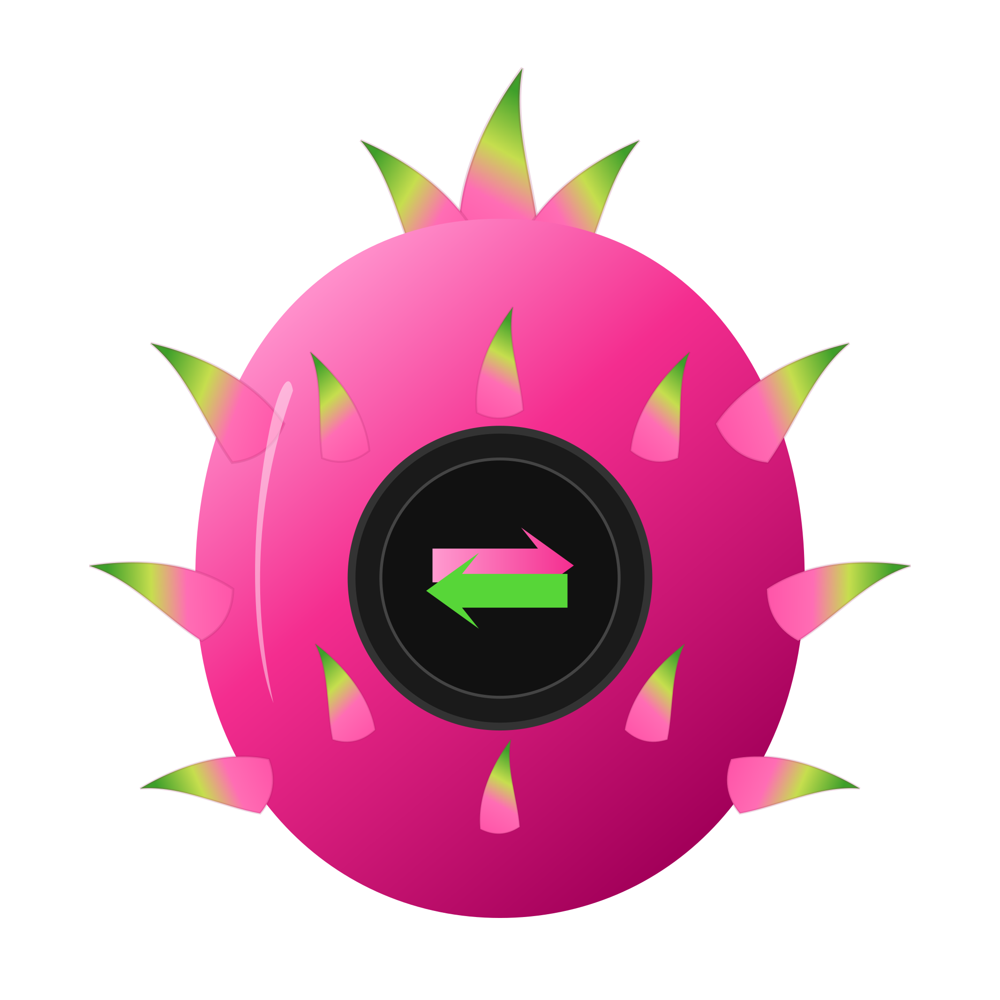

<h2 align="center"><u>Pitaya Convert</u></h2>


<p align="center">
  
</p>
<h4 align="center"> Pitaya Convert  </h4>

<p align="center">
    
    
    
<br>
    
    
    
</p>

### [+] Opis
Pitaya Convert konwertuje filmy, muzykę i grafiki. Działa na Linuxie i Windowsie.

- **Akceleracja sprzętowa wykrywana automatycznie** — NVIDIA NVENC, VAAPI (AMD/Intel), Intel QSV, AMD AMF, Apple VideoToolbox.
  Każdy koder jest naprawdę testowany przy starcie; jeśli sprzętowy zawiedzie w trakcie, konwersja sama przechodzi na procesor.
- **Jakość:** wysoka, zbalansowana, mały plik albo *bez ponownego kodowania* (natychmiastowa zmiana kontenera, gdy formaty na to pozwalają).
- Postęp z prędkością i czasem do końca, przerwanie w dowolnym momencie, pliki wynikowe nigdy nie nadpisują istniejących (`film_pitaya.mp4`, `film_pitaya (2).mp4`…).
- Używa systemowego FFmpeg, jeśli ma więcej możliwości (np. NVENC), w przeciwnym razie wbudowanego.

##### Obsługiwane formaty

| Wejście | Wyjście |
| --- | --- |
| **Wideo:** MP4, MKV, AVI, MOV, WEBM, FLV, TS, M4V, MPG, WMV, 3GP, M2TS, OGV | MP4, MKV, MOV, WEBM (VP9), AVI, GIF, dźwięk z filmu |
| **Audio:** MP3, WAV, FLAC, AAC, OGG, OPUS, M4A, WMA, AIFF, AMR, AC3 | MP3, M4A, AAC, OGG, OPUS, FLAC, WAV |
| **Grafika:** PNG, JPG, WEBP, BMP, TIFF, SVG, ICO, GIF, AVIF | PNG, JPG, WEBP, AVIF, TIFF, BMP, ICO (16–256 px), GIF (z animacją) |

### Dane
Ustawienia i dziennik są w `~/.config/Pitayas/Convert/` (Windows: `%APPDATA%\Pitayas\Convert`) — wspólny folder wszystkich aplikacji Pitayas (Pitaya Core).

### Testy
```bash
bash test/make-samples.sh /tmp/pitaya-samples
node test/run-tests.js /tmp/pitaya-samples
```
Test przepuszcza każdy plik przez każdy format docelowy i każdy wykryty koder.
